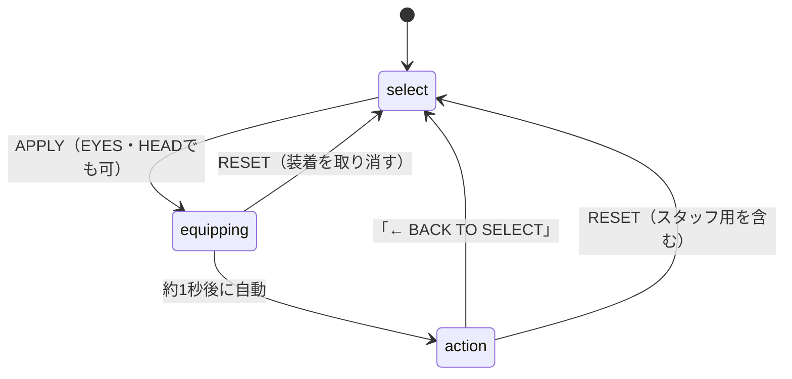

# PROJECT CHROME — フェーズ5

Webカメラ映像に、姿勢追跡を使ってサイバネティックな腕・猫耳・目のエフェクトを重ねる試作版です。

## 起動方法

1. このフォルダーを展開します。
2. ターミナルで `project-chrome` フォルダーに移動します。
3. 次を実行します。

```bash
python3 -m http.server 8000
```

4. ブラウザーで `http://localhost:8000` を開きます。
5. カメラへのアクセスを許可します。

ES Modules とカメラ API を使用するため、`index.html` をダブルクリックして `file://` で開かず、ローカルサーバー経由で起動してください。MediaPipe と Three.js の読み込みにはインターネット接続が必要です。

## チーム開発・自動検査

通常のPR先は `develop`、`develop` から `main` への最終マージは管理者本人が行います。
検査はこのフォルダーの一つ上（リポジトリのルート）で実行します。

```bash
npm ci --ignore-scripts --no-audit --no-fund
npm run lint
npm test
```

CIの配置方法・必須check・手動カメラ確認は [CI_SETUP.md](../CI_SETUP.md) を参照してください。

## フォルダー構成

```text
project-chrome/
├── index.html       ページ構造
├── css/
│   └── style.css    見た目・レイアウト
├── js/
│   ├── main.js      起動、描画ループ、UIイベントの統合
│   ├── config.js    デザイン一覧と初期設定
│   ├── tracking.js  One Euro フィルター
│   ├── arms.js      GLBモデル読み込みヘルパー
│   ├── face.js      猫耳ジオメトリ
│   └── ui.js        UI共通ヘルパー（段階的な分離用）
└── models/          自作 .glb モデルを置く場所
```

## 自作の猫耳・腕を追加する

### 1. Blenderでモデルを作る

- Blenderでパーツを作成します。
- `File > Export > glTF 2.0` を選び、`.glb` 形式で出力します。
- 出力したファイルを `models/` に置きます。
- モデルの原点、向き、スケールを確認します。腕は上腕・前腕・手を分けると追跡に合わせやすくなります。

### 2. GLB読み込みヘルパー

`js/arms.js` には Three.js の `GLTFLoader` を使う `loadGLB()` を用意しています。読み込んだモデルを既存の追跡グループに追加する処理は、モデルの原点・向き・スケールを確認してから接続してください。

現時点では、既存の円柱・球体による腕とコード生成の猫耳がデフォルトです。GLBヘルパーは追加済みですが、モデルファイルがない状態でも従来の表示が維持されます。自作モデルの自動選択UIや、GLBへの完全な置き換えは次の実装ステップです。

### 3. 猫耳の形をコードで調整する

`js/face.js` の `earShape()` で輪郭を編集できます。より複雑な造形にしたい場合はBlenderで作った `.glb` を使う方法がおすすめです。

## 体験の流れ（状態遷移）

### 状態図



※ RESETはどの状態からでも mk1・腕非表示・ARMS表示の初期状態に戻ります。図では代表的な経路だけを描いています。

### 状態ごとの画面とボタン

| 状態 | 右パネル | 映像上の腕 | ボタンの表示 | 案内 |
|---|---|---|---|---|
| select（装備選択） | 表示 | 表示しない | APPLY（有効）、RESET（表示） | なし |
| equipping（装着中） | 表示 | 表示しない | APPLY（無効）、RESET（表示） | 「装着中…」（約3秒で消えるトースト） |
| action（体験） | 非表示（映像を広げる） | 表示 | BACK（表示）、GUIDE（表示）、RESET（非表示） | GUIDEを押すと操作の説明を表示 |

### 遷移条件

| 操作・イベント | 有効な状態 | 結果 | 無効なときの扱い |
|---|---|---|---|
| APPLY（ARMS・EYES・HEAD） | select | equipping に入り、約1秒後に action へ進む | equipping中は無視（連打防止） |
| APPLY（action中） | action | いったん select に戻してから装着し直す | — |
| 約1秒の経過（完了） | equipping | action へ進む | 古い装着の完了は無視する |
| BACK TO SELECT | action | select に戻る。選んでいた装備は残る | — |
| RESET（来場者用） | すべて | 初期状態に戻し、装着中の完了も取り消す | — |
| スタッフ用リセット（Ctrl + Shift + R） | すべて | RESETと同じ初期化 | 確認欄でEnterを押したときだけ実行 |

### 追跡喪失の扱い

- 腕を見失っても **状態（phase）は変わりません**。action のまま、腕だけ非表示になります。
- 再び映ると、同じ action の中で腕が戻ります。
- 追跡の状態は、画面右上の「POSE TRACKING」と右下の「TRACKING」で確認できます。

### その他の注意

- 装着中に BACK や RESET を押すと、待機中の装着は取り消されます。
- EYES・HEADでの変更（目の色、猫耳など）は、APPLYを押さなくても即時に反映されます。
- 状態の判定ロジックは `js/experience.js` にあり、`tests/experience.test.mjs` で確認しています。

### スタッフ用リセット（来場者は使いません）

- **Ctrl + Shift + R** で確認欄を出します。
- **Enter** で実行、**Esc** で取り消しです。
- 実行すると、装備・目・耳・腕・タブを初期状態（mk1、ARMS表示）に戻します。
- 来場者向けのRESETと同じ初期化処理を通ります。


## 注意

- カメラ映像と追跡処理はブラウザー内で動作します。
- MediaPipe/Three.js のライブラリとモデルファイルは外部URLから読み込むため、起動時にインターネット接続が必要です。
- この分割版は元の `faz5.html` の挙動をできるだけ維持する安全寄りの初回整理です。UIイベントや追跡処理の完全な独立化は、動作確認しながら段階的に進めてください。
